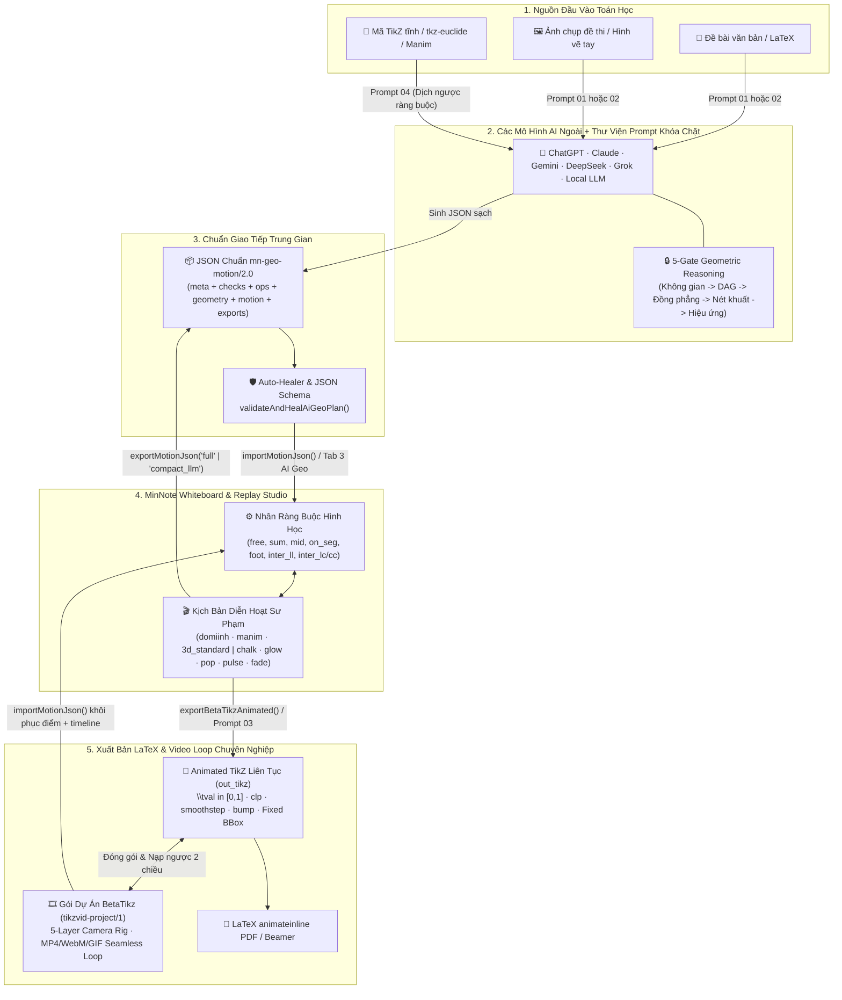

# Thư Viện Prompt & Chuẩn Giao Tiếp Hình Học Chuyển Động MinNote (`mn-geo-motion/2.0`)

Thư mục `prompts/` cung cấp **bộ chuẩn ngôn ngữ trung gian hai chiều (`mn-geo-motion/2.0`)** và hệ thống **Prompt Khóa Chặt Hình Học (Geometric Constraint-Locked Prompts)** kết nối liền mạch giữa:
1. **Đề bài Toán / Ảnh chụp đề thi** (tự luận, trắc nghiệm, bảng Đúng/Sai 4 ý, hình vẽ SGK/viết tay),
2. **Mọi mô hình AI bên ngoài** (ChatGPT, Claude, Google Gemini, DeepSeek, Grok, Qwen/Llama Local LLM, Antigravity CLI),
3. **Bảng dựng hình tham số & Kịch bản hiệu ứng MinNote** (`MinNoteAiGeo` + `MinNoteGeoReplay` + `MinNoteMotionBridge`),
4. **Mã TikZ Chuyển Động liên tục (`out_tikz` / `animateinline`)** và **Hệ thống xuất Video Loop 60fps BetaTikz (`tikzvid-project/1`)**.

---

## 1. Kiến Trúc Tổng Thể & Luồng Dữ Liệu Hai Chiều

---

## 2. Danh Mục Tài Liệu & Ma Trận Chọn Prompt Tối Ưu

| Tệp tài liệu | Mục đích sử dụng | Chi phí Prompt | Mô hình khuyên dùng | Khi nào nên chọn? |
| :--- | :--- | :---: | :--- | :--- |
| [`01_problem_to_minnote_motion_json.md`](./01_problem_to_minnote_motion_json.md) | **Đề Toán / Ảnh đề → JSON `mn-geo-motion/2.0`** kèm khóa suy luận 5 cổng (5-Gate Reasoning) | ~1.350 tokens | GPT-4o/o3, Claude Sonnet/Opus, Gemini Pro/Flash, DeepSeek-R1/V3 | Bài hình 3D nhiều giao tuyến, thiết diện, khoảng cách, đường tròn tiếp tuyến cần độ chính xác **100% không sai hình**. |
| [`02_ultra_compact_token_saver.md`](./02_ultra_compact_token_saver.md) | **Prompt Siêu Gọn Tiết Kiệm Token** (~410 tokens) giữ nguyên 100% luật chống lỗi cốt lõi | **~410 tokens** *(giảm ~70%)* | Gemini Flash, GPT-4o-mini, DeepSeek-V3, Qwen-2.5/3 Local, Batch API | Gọi API hàng loạt (ngân hàng câu hỏi trăm câu), nhúng nút *Chép Prompt Mẫu*, hoặc dùng LLM nhỏ cần phản hồi nhanh. |
| [`03_json_to_betatikz_video_loop.md`](./03_json_to_betatikz_video_loop.md) | **JSON `mn-geo-motion/2.0` / TikZ tĩnh → BetaTikz Video Loop (`tikzvid-project/1`)** | ~1.100 tokens | Claude Sonnet, Gemini Pro, DeepSeek-V3, GPT-4o | Khi muốn AI nâng cấp kịch bản thành phim toán học liên tục `t ∈ [0,1]` 5 tầng (Camera zoom, đường gióng động, công thức chạy, vòng lặp mượt). |
| [`04_tikz_to_minnote_motion_json.md`](./04_tikz_to_minnote_motion_json.md) | **Mã TikZ / `tkz-euclide` / Manim → JSON `mn-geo-motion/2.0`** (nâng cấp tọa độ chết thành ràng buộc động) | ~950 tokens | Mọi LLM tầm trung trở lên | Khi có sẵn kho đề LaTeX/TikZ tĩnh muốn đưa vào MinNote để **kéo thả đỉnh không vỡ hình** và tự gán hiệu ứng giảng bài từng nét. |
| [`05_ai_geometry_20_errors_and_fixes.md`](./05_ai_geometry_20_errors_and_fixes.md) | **Cẩm nang 20 Lỗi Kinh Điển của AI khi dựng hình Toán** & mẫu sửa chuẩn | Tài liệu tra cứu & Fine-tune | Dành cho Kỹ sư Prompt, Giáo viên & QA | Khi kiểm tra vì sao AI vẽ đáy tự cắt hình nơ, giao điểm chéo nhau 3D giả, tiếp tuyến lệch góc vuông, hoặc nhảy khung video. |
| [`schemas/mn-geo-motion-v2.schema.json`](./schemas/mn-geo-motion-v2.schema.json) | **JSON Schema Draft 2020-12 chính thức** của chuẩn `mn-geo-motion/2.0` | Tệp Schema | OpenAI/Gemini Structured Outputs, `agy --json-schema`, trình kiểm thử | Ép đầu ra API trả về JSON hợp lệ tuyệt đối 100%, không bao giờ thừa chữ hay sai kiểu dữ liệu. |

---

## 3. Bộ Ví Dụ Chuẩn Vàng (`examples/`)

1. [`examples/01_chop_tu_giac_giao_tuyen_3d.json`](./examples/01_chop_tu_giac_giao_tuyen_3d.json)
   - **Chủ đề**: Hình chóp tứ giác lồi $S.ABCD$, tìm giao tuyến $SO = (SAC) \cap (SBD)$, giao điểm $I = SD \cap (ABM)$, dựng thiết diện $ABMI$ và giao tuyến $Ax = (AMN) \cap (ABCD) \parallel CD$.
   - **Đặc trưng**: Phong cách `domiinh` với hiệu ứng nét phấn `chalk`, nảy điểm `pop`, phát sáng giao tuyến `glow`, nhịp nhấn kết luận `pulse`, tô mặt `fade` và vòng lặp `loop: true`.
2. [`examples/02_duong_tron_tiep_tuyen_2d.json`](./examples/02_duong_tron_tiep_tuyen_2d.json)
   - **Chủ đề**: Đường tròn $(O; R)$ và hai tiếp tuyến $AB, AC$ kẻ từ điểm $A$ nằm ngoài đường tròn, dây cung tiếp điểm $BC \perp OA$ tại $H$.
   - **Đặc trưng**: Dựng tiếp điểm chính xác tuyệt đối ($\widehat{OBA} = \widehat{OCA} = 90^\circ$) qua đường tròn Thales đường kính $OA$ kết hợp `intersection_lc`, kịch bản phong cách `manim`.
3. [`examples/03_betatikz_chop_video_loop.betatikz.json`](./examples/03_betatikz_chop_video_loop.betatikz.json)
   - **Chủ đề**: Gói dự án chuẩn `"format": "tikzvid-project/1"` mở trực tiếp trong **BetaTikz** để xuất video MP4 1080p/4K vòng lặp mượt, đồng thời nạp ngược được vào **MinNote** với đầy đủ ràng buộc điểm và các mốc thời gian `[tStart, tEnd]`.

---

## 4. Quy Trình Sử Dụng Nhanh Trong Thực Tế

### Cách 1: Dùng AI ngoài (ChatGPT / Claude / Gemini / DeepSeek miễn phí) → Dán vào MinNote
1. Mở [`02_ultra_compact_token_saver.md`](./02_ultra_compact_token_saver.md) (nhanh gọn) hoặc [`01_problem_to_minnote_motion_json.md`](./01_problem_to_minnote_motion_json.md) (bài khó 3D), sao chép khung Prompt.
2. Dán Prompt kèm **ảnh chụp đề bài** hoặc **văn bản đề bài** vào ChatGPT / Claude / Gemini / DeepSeek.
3. Sao chép khối JSON kết quả → Mở MinNote → **✨ AI Dựng Hình (`Ctrl + Alt + G`)** → Tab **🔄 JSON & Chuyển Động** (hoặc **Studio Chuyển Động `Ctrl + Alt + J`**) → Dán JSON → Bấm **🚀 Nạp Hình & Chạy Chuyển Động Ngay**.
4. Bộ tự chữa lỗi `validateAndHealAiGeoPlan` của MinNote sẽ tự kiểm định lần cuối, dựng hình khóa chặt ràng buộc và phát diễn hoạt từng nét trên bảng!

### Cách 2: Chỉnh sửa trên MinNote → Xuất sang AI khác hoặc BetaTikz Render Video 4K
1. Sau khi dựng hoặc tinh chỉnh hình và hiệu ứng từng bước trên bảng MinNote, bấm nút **🔄 JSON / BetaTikz** trên thanh Kịch bản (hoặc nhấn `Ctrl + Alt + J`).
2. Chọn chế độ xuất phù hợp:
   - **🤖 Siêu gọn cho LLM (`compact_llm`)**: Tiết kiệm ~65% token để gửi lại cho ChatGPT/Claude nhờ viết thêm lời giảng lồng tiếng hoặc mở rộng câu d, e.
   - **📦 Dự án BetaTikz (`.betatikz.json`)**: Mở thẳng trong ứng dụng `Beta1Tikz` để render video MP4 chuẩn H.264/BT.709 sắc nét không giật khung.
   - **📄 Mã LaTeX `animateinline` (`.tex`)**: Chèn trực tiếp vào slide Beamer hoặc tài liệu PDF tương tác.

### Cách 3: Tích hợp Tự động qua API / CLI (`Structured Outputs`)
Truyền trực tiếp tệp [`schemas/mn-geo-motion-v2.schema.json`](./schemas/mn-geo-motion-v2.schema.json) vào tham số `response_format` (OpenAI / DeepSeek / vLLM), `responseSchema` (Gemini API), hoặc cờ `--json-schema` để đảm bảo 100% phản hồi tuân thủ lược đồ `mn-geo-motion/2.0`.
