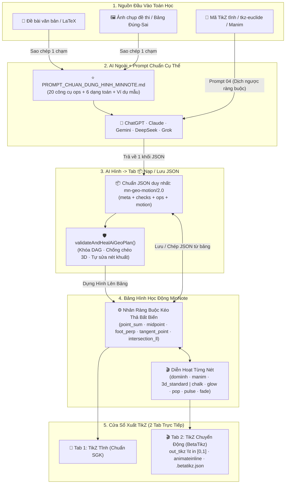

# Thư Viện Prompt & Chuẩn Giao Tiếp Hình Học Động MinNote (`mn-geo-motion/2.0`)

> [!IMPORTANT]
> ### ⭐ TỆP QUAN TRỌNG NHẤT — SAO CHÉP 1 CHẠM DÙNG NGAY: [`PROMPT_CHUAN_DUNG_HINH_MINNOTE.md`](./PROMPT_CHUAN_DUNG_HINH_MINNOTE.md)
> Nếu bạn muốn nhờ **ChatGPT, Claude, Google Gemini, DeepSeek hoặc Grok** đọc đề bài (hoặc ảnh chụp đề bài) và dựng hình chuẩn xác lên bảng MinNote, **chỉ cần mở duy nhất tệp [`PROMPT_CHUAN_DUNG_HINH_MINNOTE.md`](./PROMPT_CHUAN_DUNG_HINH_MINNOTE.md)**!
> - Toàn bộ **Từ điển 20 công cụ dựng hình gốc (`ops`) kèm cú pháp JSON đầy đủ**, **Hướng dẫn dựng từng bước 6 dạng toán trọng tâm 2D/3D**, **Hệ thống hiệu ứng diễn hoạt** và **Ví dụ JSON mẫu hoàn chỉnh** đều nằm gọn trong **01 khung sao chép duy nhất**.
> - Nội dung này cũng được tích hợp sẵn ngay trong ứng dụng tại: **`✨ AI Hình` (`Ctrl + Alt + G`) → tab `📦 Nạp / Lưu JSON` → nút `📋 Chép Prompt Dựng Hình Chi Tiết`**.

---

## 1. Phân Tách Rõ Ràng Giữa JSON & TikZ Trong MinNote (`v0.0.9.11`)

MinNote tách biệt rành mạch hai luồng làm việc để giao diện gọn nhẹ, không chồng chéo:

1. **Luồng JSON Hình Học Động — Cửa sổ `✨ AI Hình` (`Ctrl + Alt + G`) → tab `📦 Nạp / Lưu JSON`**:
   - **Chép Prompt**: Bấm **`📋 Chép Prompt Dựng Hình Chi Tiết`** (hoặc bấm **`👁 Xem nội dung Prompt`** để đọc trực tiếp toàn bộ từ điển 20 công cụ ngay trong hộp thoại).
   - **Nạp & Lưu 01 chuẩn JSON duy nhất (`mn-geo-motion/2.0`)**: Dán khối JSON từ AI ngoài, mở tệp `.json` (`📂 Mở tệp .json`), hoặc lưu hình đang có trên bảng ra tệp `.json` sạch gọn (`💾 Lưu bảng ra .json` / `📋 Chép JSON từ bảng`), rồi bấm **`🚀 Dựng Hình Lên Bảng`**.
2. **Luồng Mã TikZ Tĩnh & TikZ Chuyển Động — Cửa sổ `📐 Xuất TikZ`**:
   - Chuyển đổi trực tiếp giữa **2 tab ngay trong cùng một khung xem mã TikZ**:
     - Tab **`📐 TikZ Tĩnh (Chuẩn SGK)`**: Xuất mã TikZ phẳng/không gian chuẩn sách giáo khoa & đề thi THPT (tọa độ lưới nguyên $\mathbb{Z}^2$, kiểm định 12 quy tắc Preflight, đẩy sang Kho hình MatrixExamAI Pro).
     - Tab **`🎬 TikZ Chuyển Động (BetaTikz)`**: Hiển thị tức thì mã TikZ diễn hoạt liên tục **`out_tikz` (`\t ∈ [0, 1]`)** cho BetaTikz hoặc **`LaTeX animateinline`** cho PDF/Beamer, kèm thanh xem trước trục thời gian và nút lưu gói dự án **`.betatikz.json`**.

---

## 2. Kiến Trúc Tổng Thể & Luồng Dữ Liệu Hai Chiều

---

## 3. Danh Mục Đầy Đủ Các Tài Liệu Trong `prompts/`

| Tệp tài liệu | Vai trò chính | Đối tượng sử dụng | Khi nào nên mở? |
| :--- | :--- | :--- | :--- |
| ⭐ **[`PROMPT_CHUAN_DUNG_HINH_MINNOTE.md`](./PROMPT_CHUAN_DUNG_HINH_MINNOTE.md)** | **#1 Flagship Master Prompt (1 khung copy duy nhất)** chứa trọn vẹn 20 công cụ `ops`, 6 dạng toán mẫu, hiệu ứng & JSON mẫu hoàn chỉnh | Giáo viên, Học sinh & Mọi mô hình AI ngoài | **Mặc định dùng cho 95% nhu cầu hằng ngày**: chỉ cần copy toàn bộ khung, dán đề/ảnh đề ở cuối là dựng chuẩn ngay! |
| [`01_problem_to_minnote_motion_json.md`](./01_problem_to_minnote_motion_json.md) | **System Prompt + User Prompt tách rời** theo chuẩn Khóa Suy Luận 5 Cổng (`5-Gate Checks`), nhúng đầy đủ cú pháp JSON 20 công cụ & công thức dựng | Nhà phát triển ứng dụng, System Prompt cố định (Custom GPTs / Gems / Claude Projects) | Khi cài đặt cố định vào ô `System Instructions` của Custom GPT, Gemini Gem, Claude Project hoặc gọi qua SDK. |
| [`02_ultra_compact_token_saver.md`](./02_ultra_compact_token_saver.md) | **Prompt Gọn Tiết Kiệm Token (nhúng đủ cú pháp JSON 20 công cụ + công thức dựng nhanh)** | Batch API ngân hàng câu hỏi lớn, Local LLM (`Qwen`, `Llama`), Prompt Caching | Khi xử lý tự động hàng trăm/nghìn câu hỏi qua API cần giảm chi phí token nhưng vẫn đầy đủ cú pháp JSON từng công cụ. |
| [`03_json_to_betatikz_video_loop.md`](./03_json_to_betatikz_video_loop.md) | **Chuyển JSON `mn-geo-motion/2.0` / TikZ tĩnh sang Video Loop BetaTikz (`tikzvid-project/1`)** | Người làm video bài giảng Toán MP4 60fps bằng BetaTikz / Beamer | Khi muốn nhờ AI đạo diễn thêm chuyển động camera 5 tầng, công thức chạy theo biến thời gian $\t \in [0, 1]$ nâng cao. |
| [`04_tikz_to_minnote_motion_json.md`](./04_tikz_to_minnote_motion_json.md) | **Dịch ngược mã TikZ / `tkz-euclide` / Manim sang JSON ràng buộc động `mn-geo-motion/2.0`** | Giáo viên có sẵn kho đề LaTeX/TikZ tĩnh | Khi muốn biến hình TikZ tọa độ chết thành hình động trên MinNote (kéo thả đỉnh không gãy hình + có hiệu ứng từng nét). |
| [`05_ai_geometry_20_errors_and_fixes.md`](./05_ai_geometry_20_errors_and_fixes.md) | **Cẩm nang 20 Lỗi Kinh Điển của AI khi dựng hình Toán & cách khắc phục** | Giáo viên, Kỹ sư Prompt & Kiểm thử QA | Tài liệu tra cứu chuyên sâu về nguyên nhân toán học và mẫu sửa chuẩn cho 20 lỗi hình học 2D/3D phổ biến của LLM. |
| [`schemas/mn-geo-motion-v2.schema.json`](./schemas/mn-geo-motion-v2.schema.json) | **JSON Schema Draft 2020-12 chính thức** của chuẩn `mn-geo-motion/2.0` | OpenAI / Gemini Structured Outputs, `agy --json-schema`, CI/CD | Ép API của các hãng AI trả về 100% đúng kiểu dữ liệu JSON Schema, không bao giờ sai trường hay thừa văn bản. |

---

## 4. Bộ Ví Dụ Chuẩn Vàng (`examples/`)

1. [`examples/01_chop_tu_giac_giao_tuyen_3d.json`](./examples/01_chop_tu_giac_giao_tuyen_3d.json)
   - **Nội dung**: Hình chóp tứ giác lồi $S.ABCD$, tìm giao tuyến $SO = (SAC) \cap (SBD)$, giao điểm $I = SD \cap (ABM)$, dựng thiết diện $ABMI$ và giao tuyến song song $Ax = (AMN) \cap (ABCD) \parallel CD$ (phong cách `domiinh`).
2. [`examples/02_duong_tron_tiep_tuyen_2d.json`](./examples/02_duong_tron_tiep_tuyen_2d.json)
   - **Nội dung**: Đường tròn $(O; R)$ và hai tiếp tuyến $AB, AC$ kẻ từ điểm ngoài $A$ qua đường tròn Thales đường kính $OA$ ($\widehat{OBA} = \widehat{OCA} = 90.000^\circ$ bất biến khi kéo thả), dây cung $BC \perp OA$ tại $H$ (phong cách `manim`).
3. [`examples/03_betatikz_chop_video_loop.betatikz.json`](./examples/03_betatikz_chop_video_loop.betatikz.json)
   - **Nội dung**: Gói dự án video vòng lặp chuẩn `"format": "tikzvid-project/1"` mở trực tiếp trong **BetaTikz** để xuất MP4 1080p/4K, đồng thời nạp ngược được vào tab **`📦 Nạp / Lưu JSON`** của MinNote.

---

## 5. Hướng Dẫn Thao Tác Nhanh 3 Bước

1. **Bước 1 — Tạo JSON từ Đề bài / Ảnh đề**:
   - Mở [`PROMPT_CHUAN_DUNG_HINH_MINNOTE.md`](./PROMPT_CHUAN_DUNG_HINH_MINNOTE.md) (hoặc bấm **`📋 Chép Prompt Dựng Hình Chi Tiết`** trong **`✨ AI Hình → 📦 Nạp / Lưu JSON`**).
   - Dán vào ChatGPT / Claude / Gemini / DeepSeek kèm nội dung đề bài hoặc ảnh chụp đề bài.
2. **Bước 2 — Dựng Hình & Diễn Hoạt Trên Bảng MinNote**:
   - Sao chép khối JSON kết quả → Dán vào ô JSON trong tab **`📦 Nạp / Lưu JSON`** → Chọn phong cách (`✨ Đỗ Miinh`, `🎬 Manim`, hoặc `🧊 3D Chuẩn`) → Bấm **`🚀 Dựng Hình Lên Bảng`**.
3. **Bước 3 — Xuất Mã TikZ Tĩnh hoặc TikZ Chuyển Động (Khi cần chèn LaTeX / Làm Video)**:
   - Bấm nút **`📐 Xuất TikZ`** trên thanh công cụ:
     - Giữ ở tab **`📐 TikZ Tĩnh (Chuẩn SGK)`** để chép mã TikZ chèn vào đề thi Word/LaTeX.
     - Chuyển sang tab **`🎬 TikZ Chuyển Động (BetaTikz)`** để xem ngay mã TikZ động `\t ∈ [0, 1]`, sao chép vào BetaTikz hoặc bấm **`📦 Lưu gói .betatikz.json`**.
